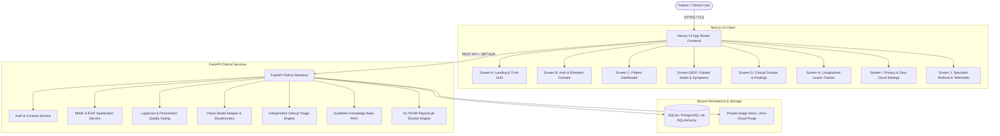

# SkinWise AI — Production-Grade Dermatological Triage Platform

An evidence-based, medically audited, SaMD CE Class I aligned skin health assessment web application built with **Next.js 14 App Router (TypeScript)**, **Tailwind CSS**, and **Python FastAPI**.

Developed strictly against the approved **Google Stitch UI Specification** (`projects/2973201184690865371`, "SkinWise AI Platform Design").

---

## 🏛️ System Architecture



---

## 🩺 Clinical & Regulatory Principles

1. **Informational Triage, Non-Diagnostic SaMD**:
   - Explicitly designed as a CE Class I clinical decision support aid.
   - It does **not** provide definitive diagnoses or replace in-person dermatological consultations.
2. **Deterministic Emergency Precedence**:
   - Clinical red flags (anaphylaxis signs, facial/lip swelling, respiratory distress, petechiae, fever with rapidly spreading rash, widespread peeling skin) trigger immediate Tier 3 emergency escalation.
   - Emergency signs take **absolute precedence** over reassuring image-classification scores.
3. **Optical Viability Quality Gating**:
   - Every submitted dermoscopic photograph undergoes automated quality checks before clinical evaluation:
     - **Focus / Sharpness**: Laplacian variance threshold ($\ge 50.0$).
     - **Lighting / Illumination**: Photometric perceived luminance ($\ge 35.0$ lux equivalent).
     - **Specular Flash Glare**: Glare ratio ceiling ($\le 18\%$).
   - Blurry or underexposed imagery triggers explicit user guidance rather than hallucinated classifications.
4. **Zero-Cloud Image Scrubbing & HIPAA/GDPR Compliance**:
   - Zero-cloud retention mode permanently expunges raw imagery from disk immediately post-inference.
   - EXIF metadata (GPS location, camera serials, timestamps) is stripped upon intake.
   - Full patient self-deletion and JSON data portability endpoints.
5. **Traceable Clinical Evidence**:
   - All care pathways reference accredited sources: **American Academy of Dermatology (AAD)**, **British Association of Dermatologists (BAD)**, **DermNet NZ**, **WHO**, and **NCCN**.

---

## 🚀 Quick Start Guide

### Prerequisites
- **Node.js** v18+ and `npm`
- **Python** 3.10+ (or Python 3.12 with `uv`)

### Automated Launch (Windows PowerShell)
Run the all-in-one launcher script:
```powershell
.\start.ps1
```
This automatically boots:
- **FastAPI Backend**: `http://127.0.0.1:8000` (Swagger docs at `/docs`)
- **Next.js Frontend**: `http://localhost:3000`

---

### Manual Launch

#### 1. Backend Setup (FastAPI)
```bash
cd backend

# Create and activate virtual environment
python -m venv .venv
# On Windows:
.venv\Scripts\activate
# On Linux/macOS:
source .venv/bin/activate

# Install dependencies
pip install -r requirements.txt

# Run database initialization and test suite
python -m pytest app/tests

# Start the API server
uvicorn app.main:app --host 127.0.0.1 --port 8000 --reload
```

#### 2. Frontend Setup (Next.js 14)
```bash
cd frontend

# Install node modules
npm install

# Build production bundle
npm run build

# Start development server
npm run dev
```
Open [http://localhost:3000](http://localhost:3000) in your browser.

---

## 🧪 Automated Test Suite

The backend includes a comprehensive pytest suite verifying critical clinical and security requirements:

| Test File | Verification Area |
|---|---|
| `test_auth.py` | Password hashing, JWT auth, biometric consent enforcement |
| `test_image_quality.py` | Laplacian sharpness, lux levels, and specular flash glare gating |
| `test_triage_escalation.py` | Emergency red flag override over reassuring AI confidence |
| `test_ml_evaluation.py` | Morphometric ABCDE calculation, entropy, and out-of-distribution handling |
| `test_assessments_api.py` | End-to-end multipart intake, triage, and patient self-deletion |

Run tests:
```bash
cd backend
.venv\Scripts\python.exe -m pytest app/tests -v
```

---

## 📋 Pre-Seeded Demonstration Account

The backend automatically creates a demonstration account upon first startup:
- **Email**: `sarah.jenkins@example.com`
- **Password**: `SkinWise2026!`
- **Role**: Patient with verified consent and sample baseline clinical assessment.

